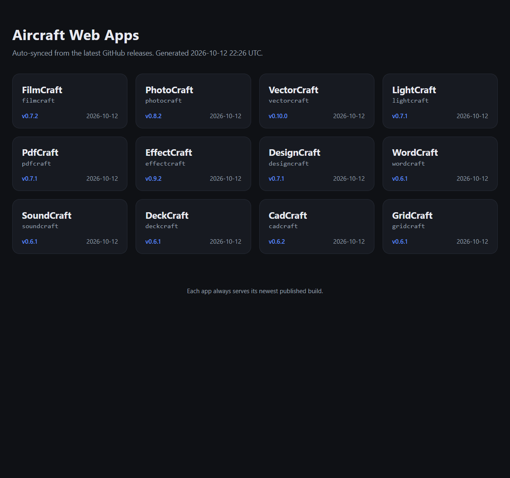

# artcraft-web-auto

[English](README.md) | [简体中文](README_zh.md)

Automatically sync and deploy the **latest web builds** of the ArtCraft app suite (FilmCraft / PhotoCraft / …) to GitHub Pages, using scheduled GitHub Actions jobs.

- Checks each repository's `releases/latest` daily (manual trigger also supported)
- Downloads and extracts the matching `{app}-web-{version}.zip` only when the version changes (incremental, bandwidth-friendly)
- Flattens the single top-level directory inside the zip and overwrites `/{app}/` at the site root
- **Stable URLs per app, always pointing to the newest build**: `https://<user>.github.io/artcraft-web-auto/filmcraft/`
- Top-level `index.html` is an aggregate landing page listing all apps with their versions

## Preview

Landing page auto-generated by the sync job — live at [https://nyr-github.github.io/artcraft-web/](https://nyr-github.github.io/artcraft-web/):



## Supported apps

`filmcraft`, `photocraft`, `vectorcraft`, `lightcraft`, `pdfcraft`, `effectcraft`, `designcraft`, `wordcraft`, `soundcraft`, `deckcraft`, `cadcraft`, `gridcraft` (all under the `storytold` organization; see `config/apps.json` for the full list).

## How it works

```
GitHub Releases (storytold/*)
        │  daily cron / manual trigger
        ▼
.github/workflows/sync-web-apps.yml
        │  invokes
        ▼
scripts/sync.mjs ── reads versions.json on gh-pages, compares latest versions
        │            version changed → download zip → flatten → overwrite gh-pages/<app>/
        │            version unchanged → skip, keep existing files
        ▼
gh-pages branch (GitHub Pages site root)
   ├── index.html       aggregate landing page (auto cards + versions)
   ├── manifest.json    machine-readable manifest (app → version / path / updated time)
   ├── versions.json    incremental sync state (last deployed versions)
   ├── .nojekyll        disable Jekyll so _headers etc. are not ignored by Pages
   └── <app>/            latest web build per app (relative paths, works under any subpath)
```

All web builds load resources with **relative URLs** (see `HOSTING.md` inside the builds: "Any path works"), so placing them under `/{app}/` subpaths works out of the box with no base rewriting. GitHub Pages natively serves `.wasm` as `application/wasm`, and the builds do not depend on COOP/COEP, so they run directly on Pages.

## One-time setup (after pushing to GitHub)

1. Create a new GitHub repository (e.g. `artcraft-web-auto`) and push this directory's content to the default branch (e.g. `main`).
2. **Settings → Pages** → Source: `Deploy from a branch` → Branch: `gh-pages`, directory: `/(root)` → Save.
   (The first sync run automatically creates the `gh-pages` branch; before that, this option may not list `gh-pages` — just run the workflow manually once first.)
3. Make sure **Settings → Actions → General → Workflow permissions** allows read/write, or rely on the workflow's own `permissions: contents: write` (already declared in this project).
4. Go to **Actions → Sync web apps → Run workflow** to trigger it manually, or wait for the daily cron.

> Uses the built-in `GITHUB_TOKEN`; no extra secrets needed. Scheduled jobs download public artifacts from `github.com` and query the API with sufficient authentication.

## Schedule & manual trigger

- Cron: `0 3 * * *` (UTC 03:00, roughly 11:00 Beijing time). To change the time, edit `schedule.cron` in `.github/workflows/sync-web-apps.yml`.
- Manual: click `Run workflow` on the Actions page. Optional inputs:
  - `force`: ignore version comparison and re-download all apps
  - `only`: comma-separated app ids to sync only a subset (e.g. `filmcraft,gridcraft`)

## Running locally / debugging

Requires Node 20+, plus system `curl` and `unzip` (or `tar`).

```bash
# Dry run: only check versions, no downloads or writes
node scripts/sync.mjs --dest ./.out --dry-run

# Sync a single app only
node scripts/sync.mjs --dest ./.out --only gridcraft

# Force a full re-download
node scripts/sync.mjs --dest ./.out --force

# Optional: set the Pages base path (default "./"); ORG overrides the organization name
PAGES_BASE=./ ORG=storytold node scripts/sync.mjs --dest ./.out
```

The `--dest` directory will contain `index.html` / `manifest.json` / `versions.json`, previewable with any static server:

```bash
npx serve ./.out
```

## Adding / adjusting apps

Edit `config/apps.json`:

```json
{
  "org": "storytold",
  "apps": [
    { "id": "filmcraft", "title": "FilmCraft" },
    { "id": "newcraft", "title": "NewCraft" }
  ]
}
```

- `id`: repository name, which is also the site directory name `/{id}/`
- `title`: display name on the landing page (auto title-cased if omitted)
- To pull artifacts from a different repository, add `"repo": "other-name"` to override.

The prerequisite is that the repository's release contains a web artifact named like `{id}-web-{version}.zip` (the script matches this pattern exactly first, then falls back to any zip whose name contains `web`).

## Directory structure

```
.github/workflows/sync-web-apps.yml   # scheduled + manual sync workflow
config/apps.json                      # app list
scripts/sync.mjs                      # incremental sync core logic (no third-party deps)
docs/screenshot.png                   # landing page screenshot used in this README
.gitignore                            # ignore local .out / gh-pages artifacts
README.md                             # this document (English)
README_zh.md                          # 简体中文文档
```
